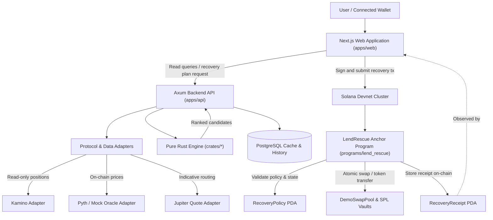
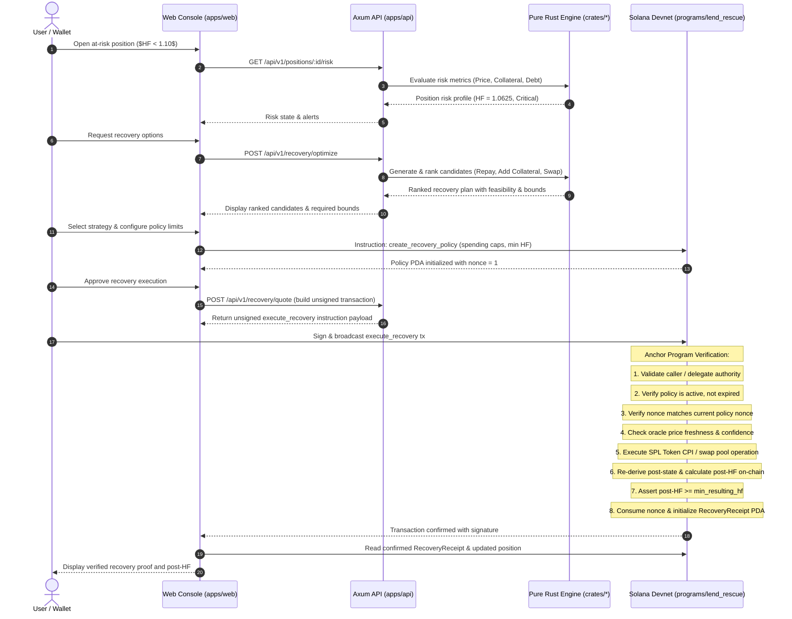
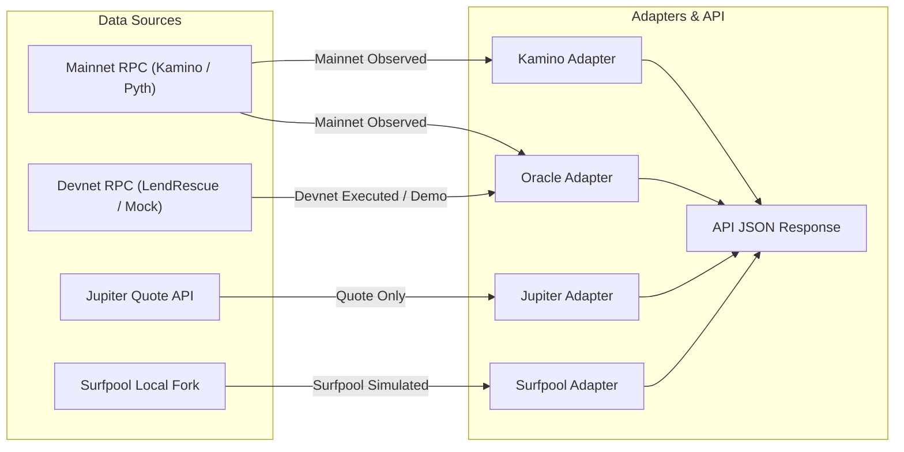

# LendRescue Architecture (`ARCHITECTURE.md`)

## 1. System Overview and Component Architecture

LendRescue separates observation, decision-making, and execution into distinct layers with rigorous trust boundaries.

---

## 2. Recovery Execution Sequence

The sequence below illustrates the flow from risk detection to on-chain enforcement and receipt generation:

---

## 3. Trust Boundaries and Authority Model

| Component | Responsibility | Trust Assumption | Private Key Access |
|---|---|---|---|
| **User Wallet** | Authorizes and signs on-chain transactions | Root owner of funds and policy author | User-held only (Never transmitted) |
| **Web Console (`apps/web`)** | UI presentation, telemetry, transaction assembly | Client-side presentation layer only | None |
| **Backend API (`apps/api`)** | Caching, route orchestration, external API adapters | Advisory only; never trusted for financial truth | None (No custody, no signing keys) |
| **Pure Rust Engine (`crates/*`)** | Deterministic calculations, fixed-point math, ranking | Deterministic domain logic; no I/O dependencies | None |
| **Anchor Program (`programs/lend_rescue`)** | On-chain policy enforcement, token CPIs, receipts | Ultimate authority for Devnet execution | Program PDA authorities only |

### 3.1 Non-Custodial Invariant
Neither the backend API, the database, nor the frontend holds or transmits user private keys. Every policy creation, parameter update, policy revocation, and recovery execution requires an explicit signature from the user's connected wallet or an explicitly designated delegate.

### 3.2 Backend Zero-Trust Enforcement
The Anchor smart contract treats the backend API as untrusted:
- The contract **does not** accept backend-asserted Health Factors as truth.
- The contract **does not** accept backend price claims; it reads validated on-chain oracle accounts.
- The contract **re-derives** post-execution balances directly from token accounts and recalculates post-$HF$ using on-chain integer math.
- If the re-derived post-$HF$ is less than `policy.min_resulting_hf`, the program aborts with a typed error (`RecoveryError::ResultingHealthFactorTooLow`).

---

## 4. Layer Responsibilities

### 4.1 Frontend (`apps/web`)
- Built with **Next.js 16** (App Router), **React 19**, **Tailwind CSS 4**, and **TypeScript 5.9**.
- Follows the Anthropic `frontend-design` aesthetic: editorial display typography, graphite/ink surfaces, restrained safety amber and deep teal accents.
- Dedicated client-only **Three.js** interactive 3D hero loaded via dynamic import, with strict DPR capping (1.5 max), `IntersectionObserver` pause on scroll, and full `prefers-reduced-motion` accessible fallbacks.
- Exposes screens: Landing (`/`), Dashboard (`/dashboard`), Position Details (`/positions/[id]`), Recovery Lab (`/recovery/[id]`), Policies (`/policies`), Activity (`/activity`), and Risk Lab (`/risk-lab`).
- Clearly surfaces provenance labels on every screen: `Mainnet Observed`, `Quote Only`, `Surfpool Simulated`, `Devnet Executed`, `Demo / Synthetic`.

### 4.2 Backend API (`apps/api`)
- Built with **Axum**, **Tokio**, and **SQLx** (PostgreSQL).
- Ingests requests, fetches oracle data, queries lending positions, and passes normalized domain objects to the pure-Rust engine.
- Assembles unsigned transaction payloads for wallet signing.
- Persists historical telemetry, cached position snapshots, and execution receipts for fast dashboard loading.
- Never serves as the authoritative source of truth for financial rules.

### 4.3 Pure Rust Domain & Recovery Engine (`crates/*`)
- Structured into three focused crates:
  1. `crates/domain-types`: Primitive types (`TokenAmount`, `Price`, `PositionSnapshot`, `RecoveryPolicy`, `HealthFactor`, `RiskStatus`).
  2. `crates/risk-engine`: Fixed-point math, synthetic Health Factor calculation, liquidation price derivation, and oracle validation.
  3. `crates/recovery-engine`: Candidate generation (`RepayDebt`, `AddCollateral`, `SwapCollateralAndRepay`), cost/fee modeling, and deterministic ranking.
- Strictly decoupled: zero dependencies on Axum, SQLx, Solana RPC, Anchor macros, or HTTP clients.
- Authoritative financial arithmetic uses checked integer and fixed-point representations. Floating-point numbers (`f32`, `f64`) are prohibited.

### 4.4 Anchor Smart Contract (`programs/lend_rescue`)
- Modular architecture with one file per instruction (`src/instructions/*.rs`) and one file per account (`src/state/*.rs`).
- Manages synthetic Devnet assets (`sSOL` collateral, `sUSDC` debt), market configurations (`MarketConfig`), mock oracles (`MockOracle`), user positions (`Position`), demo swap pools (`DemoSwapPool`), policies (`RecoveryPolicy`), and execution receipts (`RecoveryReceipt`).
- Guarantees complete atomic rollback on any failure.

---

## 5. Data Flow and Provenance

Every price, position, and recommendation carries explicit provenance metadata:

---

## 6. Environment Separation

| Environment | Purpose | RPC Endpoint | Execution Capability |
|---|---|---|---|
| **Mainnet** | Real-world obligation observation | Mainnet RPC (read-only) | Read-only; transaction signing disabled |
| **Devnet** | Synthetic recovery demonstration | `api.devnet.solana.com` | Full execution with user wallet |
| **Surfpool** | Mainnet account fork & simulation | `http://127.0.0.1:8899` | Local fork simulation only; no broadcast |

---

## 7. Failure Invariants and Atomicity

A recovery transaction must satisfy the following invariant:
$$\text{If any check fails, } \Delta \text{Balances} = 0 \land \Delta \text{State} = 0$$

Order of evaluation in `execute_recovery`:
1. Check `market_config.is_paused == false`.
2. Verify account ownerships, mint relationships, and PDA seeds.
3. Check `caller == policy.owner || caller == policy.authorized_delegate`.
4. Check `clock.unix_timestamp <= policy.expiry`.
5. Check `policy.is_active == true`.
6. Check `action` bit is set in `policy.allowed_actions`.
7. Check `args.nonce == policy.nonce`.
8. Validate oracle data (age $\le$ max allowed, confidence interval within threshold).
9. Check repayment amount $\le$ `policy.max_debt_repayment`.
10. Check collateral spend $\le$ `policy.max_collateral_spend`.
11. Check slippage $\le$ `policy.max_slippage_bps`.
12. Execute token CPIs and pool swap operations.
13. Re-read balances and recompute on-chain synthetic Health Factor.
14. Enforce `post_hf >= policy.min_resulting_hf`.
15. Increment `policy.nonce` and write `RecoveryReceipt`.
16. Emit `RecoveryExecutedEvent`.
